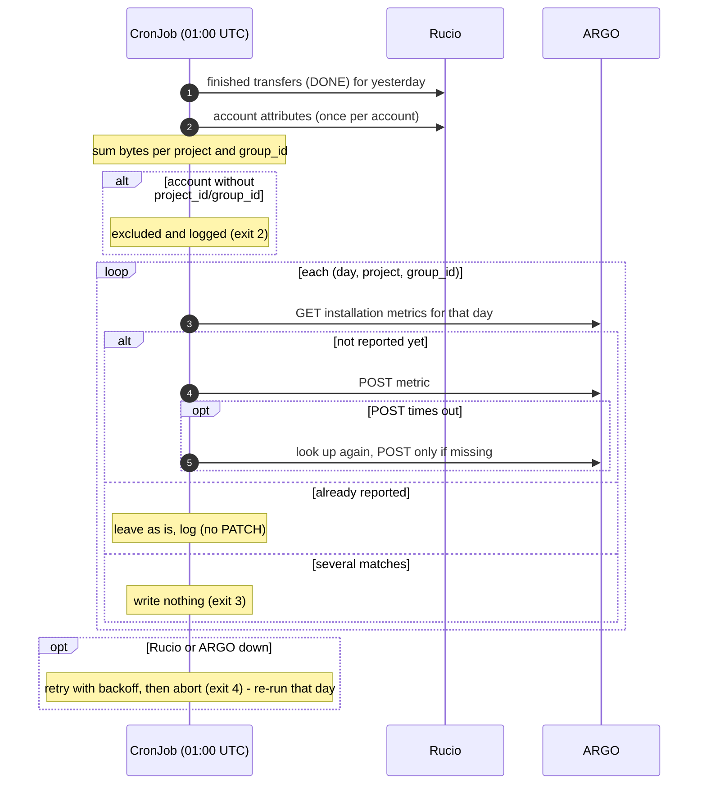

# dep-dlm-usage-reporter


Daily job that reports DEP DLM data-transfer usage from Rucio to ARGO Accounting,
per DEP project and use case (RI-SCALE). Design: [Design-001](docs/design-doc-001-usage-reporter-implementation.md).

## Getting started

Needs [uv](https://docs.astral.sh/uv/) and, for integration tests, Docker.

```
make sync       # create .venv from uv.lock (Python 3.12)
make lint       # ruff and the import contracts
make typecheck  # mypy (strict)
make test-unit  # unit tests
make help       # all targets
```

## How it works

Every night shortly after midnight UTC, the job reports yesterday's usage
once, per project and use case (`group_id`). Days already in ARGO are never
patched, so credit balances don't change after the fact.



A transfer counts once, in full, on the day it finished (`transferred_at`);
failed transfers are not counted. Behaviour and decisions:
[Design-009](https://github.com/RI-SCALE/dep-dlm-testbed/blob/main/docs/design/design-doc-009-dep-dlm-transfer-usage-reporter-for-argo-accounting.md)
and [ADR-010](https://github.com/RI-SCALE/dep-dlm-testbed/blob/main/docs/adrs/adr-010-report-transfer-usage-to-argo.md).

## Releasing

Bump the version in `pyproject.toml` and the chart, commit, push a `vX.Y.Z`
tag; `release.yml` checks that all three match, scans the image, pushes the
image and the Helm chart to GHCR and creates the GitHub Release (wheel,
sdist, chart). Every artifact carries a build-provenance attestation
(from v0.3.0 on).

```
uv version X.Y.Z
sed -i -E 's/^version: .*/version: X.Y.Z/; s/^appVersion: .*/appVersion: "X.Y.Z"/' \
  charts/dep-dlm-usage-reporter/Chart.yaml
git commit -am "chore(release): X.Y.Z"
git tag -a vX.Y.Z -m "vX.Y.Z" && git push origin main vX.Y.Z
```

Image: `ghcr.io/ri-scale/dep-dlm-usage-reporter:X.Y.Z`.
Chart: `helm install usage-reporter oci://ghcr.io/ri-scale/charts/dep-dlm-usage-reporter --version X.Y.Z`.

Verify (needs gh auth login or GH_TOKEN):

```
gh release download vX.Y.Z --repo RI-SCALE/dep-dlm-usage-reporter --pattern '*.whl'
gh attestation verify usage_reporter-X.Y.Z-py3-none-any.whl --repo RI-SCALE/dep-dlm-usage-reporter
gh attestation verify oci://ghcr.io/ri-scale/dep-dlm-usage-reporter:X.Y.Z --repo RI-SCALE/dep-dlm-usage-reporter
gh attestation verify oci://ghcr.io/ri-scale/charts/dep-dlm-usage-reporter:X.Y.Z --repo RI-SCALE/dep-dlm-usage-reporter
```