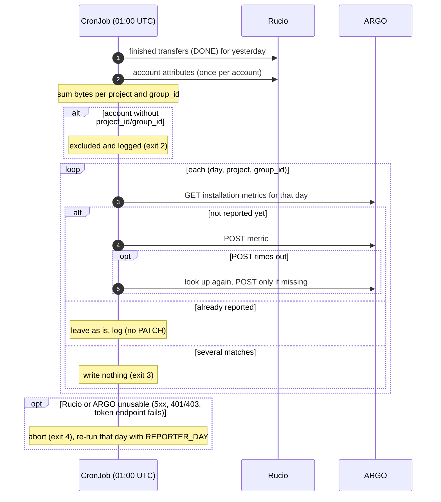

# dep-dlm-usage-reporter

Daily job that reports DEP DLM data-transfer usage from Rucio to ARGO Accounting,
per DEP project and use case (RI-SCALE). Design: [Design-001](docs/design-doc-001-usage-reporter-implementation.md).

## How it works

Every night at 01:00 UTC the job reports yesterday's usage once, per project
and use case (`group_id`). Days already in ARGO are never patched, so credit
balances don't change after the fact.



A transfer counts once, in full, on the day it finished (`transferred_at`);
failed transfers are not counted. Behaviour and decisions:
[Design-009](https://github.com/RI-SCALE/dep-dlm-testbed/blob/main/docs/design/design-doc-009-dep-dlm-transfer-usage-reporter-for-argo-accounting.md)
and [ADR-010](https://github.com/RI-SCALE/dep-dlm-testbed/blob/main/docs/adrs/adr-010-report-transfer-usage-to-argo.md).

Rucio is read with an OIDC client-credentials token in `X-Rucio-Auth-Token`.
Rucio validates it (issuer, audience, scope) and maps its `SUB=…, ISS=…` to
the reporter's account; the policy grants that token read-only access to
transfer history. A rejected token is fetched again once.

## Configuration

Environment variables, validated at startup (exit 1 if incomplete).

| Variable | Default | Purpose |
| --- | --- | --- |
| `REPORTER_RUCIO_HOST` | required | rucio-server base URL |
| `REPORTER_RUCIO_TOKEN_URL` | required | IdP token endpoint for the Rucio token |
| `REPORTER_RUCIO_CLIENT_ID` | required | Client-credentials client |
| `REPORTER_RUCIO_CLIENT_SECRET` | required | Its secret |
| `REPORTER_RUCIO_SCOPE` | none | Scopes to request; must cover Rucio's expected scope |
| `REPORTER_RUCIO_RESOURCE` | none | Resource indicator (RFC 8707); sets the token's `aud`. Needed where the IdP issues no audience otherwise (EGI Check-in) |
| `REPORTER_ARGO_ENDPOINT` | `https://api.devel.acc.argo.grnet.gr` | ARGO Accounting API |
| `REPORTER_ARGO_METRIC_DEFINITION_ID` | required | Metric definition the values are reported under |
| `REPORTER_ARGO_TOKEN_URL` | required | IdP token endpoint for ARGO tokens |
| `REPORTER_ARGO_SCOPE` | none | Scopes for ARGO tokens |
| `REPORTER_PROJECTS` | required | JSON, per project: `installation_id`, `client_id`, `client_secret_env` |
| `REPORTER_LOOKBACK_DAYS` | `0` | Earlier days to report besides yesterday |
| `REPORTER_DAY` | none | Report exactly this day (`YYYY-MM-DD`), for re-runs and backfills |
| `REPORTER_DRY_RUN` | `true` | Print the metrics as JSON lines instead of sending them |
| `REPORTER_TIMEOUT_SECONDS` | `10` | HTTP timeout (s) |

Each project's ARGO client secret is read from the variable its
`client_secret_env` names, for example:

```bash
REPORTER_PROJECTS='{"RI-SCALE_ENES": {"installation_id": "…", "client_id": "…", "client_secret_env": "REPORTER_ENES_CLIENT_SECRET"}}'
REPORTER_ENES_CLIENT_SECRET=…
```

Exit codes: `0` ok, `1` configuration error, `2` unmapped accounts,
`3` some records failed, `4` aborted (a dependency is unusable).

## Development

Needs [uv](https://docs.astral.sh/uv/) (Python 3.12) and, for integration tests, Docker.

```bash
make sync              # create .venv from uv.lock (Python 3.12)
make lint              # ruff and the import contracts
make typecheck         # mypy (strict)
make test-unit         # unit tests
make test-integration  # integration tests
make help              # all targets
```

## Releasing

Bump the version in `pyproject.toml` and the chart, commit, push a `vX.Y.Z`
tag; `release.yml` checks that all three match, scans the image, pushes the
image and the Helm chart to GHCR and creates the GitHub Release (wheel,
sdist, chart). Every artifact carries a build-provenance attestation
(from v0.3.0 on).

```bash
uv version X.Y.Z
sed -i -E 's/^version: .*/version: X.Y.Z/; s/^appVersion: .*/appVersion: "X.Y.Z"/' \
  charts/dep-dlm-usage-reporter/Chart.yaml
git commit -am "chore(release): X.Y.Z"
git tag -a vX.Y.Z -m "vX.Y.Z" && git push origin main vX.Y.Z
```

Image: `ghcr.io/ri-scale/dep-dlm-usage-reporter:X.Y.Z`.
Chart: `helm install usage-reporter oci://ghcr.io/ri-scale/charts/dep-dlm-usage-reporter --version X.Y.Z`.

Verify (needs gh auth login or GH_TOKEN):

```bash
gh release download vX.Y.Z --repo RI-SCALE/dep-dlm-usage-reporter --pattern '*.whl'
gh attestation verify usage_reporter-X.Y.Z-py3-none-any.whl --repo RI-SCALE/dep-dlm-usage-reporter
gh attestation verify oci://ghcr.io/ri-scale/dep-dlm-usage-reporter:X.Y.Z --repo RI-SCALE/dep-dlm-usage-reporter
gh attestation verify oci://ghcr.io/ri-scale/charts/dep-dlm-usage-reporter:X.Y.Z --repo RI-SCALE/dep-dlm-usage-reporter
```
